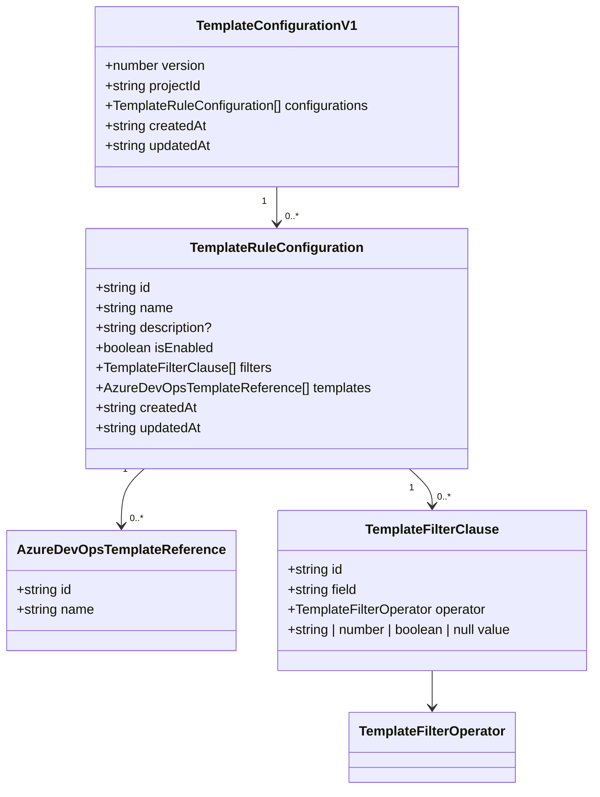

# Template configuration and storage contract

This extension uses a shared, versioned template configuration model so the settings UI, storage layer, and future generation engine all operate on the same shape.

## Model shape



The persisted configuration is a JSON document with a schema version and a project-scoped payload:

```ts
interface TemplateConfigurationV1 {
  version: 1;
  projectId: string;
  configurations: TemplateRuleConfiguration[];
  createdAt: string;
  updatedAt: string;
}
```

Each configuration groups a reusable set of filter clauses together with the Azure DevOps templates that should be created when those filters match the current work item:

```ts
interface TemplateRuleConfiguration {
  id: string;
  name: string;
  description?: string;
  isEnabled: boolean;
  filters: TemplateFilterClause[];
  templates: AzureDevOpsTemplateReference[];
  createdAt: string;
  updatedAt: string;
}
```

Templates are stored as references to the Azure DevOps templates already configured in the project, not as a full copy of the template metadata:

```ts
interface AzureDevOpsTemplateReference {
  id: string;
  name: string;
}
```

Filters remain flat and are evaluated using an implicit AND combination for now:

```ts
interface TemplateFilterClause {
  id: string;
  field: string;
  operator: "equals" | "not_equals" | "contains" | "not_contains" | "greater_than" | "greater_than_or_equals" | "less_than" | "less_than_or_equals" | "in" | "not_in";
  value: string | number | boolean | null;
}
```

## Project-scoped storage contract

The Azure DevOps extension data service is project collection scoped, so the implementation must explicitly isolate each project's configuration by project ID. The storage key pattern is:

```ts
const storageKey = `child-generator/project-templates/${encodeURIComponent(projectId)}`;
```

This provides a single collection namespace while keeping each project's template rules isolated from every other project.

## Versioning and migration

Persistence is intentionally versioned. The initial payload version is `1`, and the storage layer validates the version before reading or writing a config object. If a future extension release adds new fields, the stored value can be upgraded in-place via a migration function before the UI or generator reads it.

Recommended migration rules:

- keep the version field explicit and required
- treat the oldest known version as a supported migration target
- add new fields as optional before they are required
- normalize invalid or missing values when upgrading data

## CRUD expectations

The project storage contract is designed to support these operations without ambiguity:

- `load()` — read the current project-scoped template configuration collection
- `save(configuration)` — persist a validated, versioned configuration snapshot
- `listConfigurations()` — return the current rule configurations in order
- `addConfiguration(configuration)` — append a new configuration, rejecting duplicate ids
- `updateConfiguration(id, changes)` — replace only the targeted configuration with merged changes
- `deleteConfiguration(id)` — remove a single configuration by id and return whether it existed

This contract is suitable for both the settings drawer and the future generation engine.